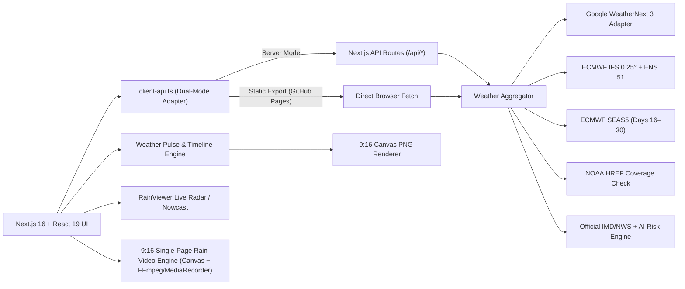

# VAANAM AI — Weather Intelligence & 9:16 Social Studio

**Live Demo:** [https://balajicts30.github.io/vaanam-ai/](https://balajicts30.github.io/vaanam-ai/)

**VAANAM AI** is a weather intelligence web application built with **Next.js 16, React 19, TypeScript, and Tailwind CSS 4**. It brings together AI and numerical weather models, live precipitation radar, a dynamic Upcoming Weather Timeline, bilingual (English & Tamil) briefings, and a unified **9:16 (1080 × 1920)** animated rain video & PNG studio.

---

## Origin & Motivation

The idea for VAANAM AI started after reading a post by **Tamilnadu Weatherman** discussing how newer AI weather models—such as **Google's WeatherNext 3**—have been getting forecasts right more often recently.

Most consumer weather apps show a single temperature and a generic icon without explaining:
- *When* weather conditions are actually expected to change over the next few hours,
- *How confident* the forecast is across ensemble members, or
- *Whether* a signal comes from a live radar observation versus a numerical weather model.

VAANAM AI was built to explore how multi-model weather data can be presented honestly, clearly, and in a format that is easy to share.

---

## Key Features

### 1. Weather Pulse Main Card & Upcoming Weather Timeline
- **Unified hierarchy inside the main dashboard card:**
  - **Header:** `VAANAM AI WEATHER PULSE`, selected location, local updated timestamp & freshness, Live Radar / Nowcast / Model Forecast status indicator, and **Share as 9:16 PNG**.
  - **Main Weather Alert:** Dynamic weather headline, estimated arrival window (only when supported by real data), visual condition badge, conversational explanation, and action recommendation.
  - **Weather Metrics:** Peak rain probability, expected rainfall, temperature & feels-like, wind speed & compass direction, and ensemble confidence.
  - **Upcoming Weather Timeline (3h / 6h):** Automatically scans upcoming hours for meaningful transitions—rain arrival, intensification, easing, thunderstorms, wind strengthening, cloud build-up, clearing skies, and significant temperature shifts—without repetitive hour-by-hour noise.
- **Interactive inspection:** Click any timeline event to inspect underlying hourly telemetry (temperature, rain probability, expected rainfall, wind, cloud cover, pressure), source provider, valid/observation timestamps, and jump directly to **Live Radar**.
- **Strict source separation:** Explicitly labels every event as `Radar Observation`, `Radar-Based Estimate`, or `Model Forecast`.

### 2. Multi-Model Aggregation & Comparison
- **Google WeatherNext 3** (`src/lib/models/weathernext.ts`) — Configurable server-side adapter for authenticated WeatherNext 3 endpoints / BigQuery / Cloud Run bridges (never fabricates readings when unconfigured).
- **ECMWF IFS 0.25°** — Primary deterministic short- and medium-range model (15 days hourly/daily).
- **ECMWF ENS (51-Member Ensemble)** — Real ensemble spread and probabilistic precipitation/heavy-rain confidence scoring.
- **ECMWF SEAS5 Extended-Range** — Days 16–30 probabilistic temperature and rainfall tendency outlooks.
- **NOAA HREF / HRRR** — Automatic coverage check for US high-resolution guidance.
- **Model Comparison View** — Cross-model agreement score and side-by-side variable comparison.

### 3. Unified 9:16 Social Weather Studio (`1080 × 1920`)
- **Single-Page Animated Rain Video:** A seamless 6-second looping `1080 × 1920` animated rain dashboard with zero scene cuts—keeping rain probability, expected rainfall, heavy-rain risk, wind, humidity, confidence, a 5-slot hourly rain timeline, and rain advisory visible on one screen with continuous falling rain streaks, drifting clouds, pulsing rain gauge, and wave-animated bars.
- **Dual Video Export Engine:**
  - **Server mode:** Frame-by-frame `@napi-rs/canvas` + `ffmpeg-static` H.264 MP4 rendering (`POST /api/studio/render-story`).
  - **Static / GitHub Pages mode:** Client-side HTML5 Canvas + `MediaRecorder` video export.
- **9:16 PNG Exports:** Both the Social Studio and the Weather Pulse card export native `1080 × 1920` (9:16) PNGs with Web Share API support.
- **10 Visual Themes & Bilingual Captions:** Editable conversational captions in **English**, **தமிழ் (Tamil)**, or **Bilingual (Tamil + EN)**.

### 4. Live Radar, Weather Maps & AI Weather Analyst
- **Live Radar (`RainViewer`):** Animated past radar frames, nowcast frames, and IR satellite cloud layers on an interactive Leaflet map.
- **Weather Maps:** Regional multi-node grid overlays for temperature, precipitation, cloud cover, wind, and pressure.
- **AI Weather Analyst:** Conversational current, daily, weekly, and 30-day briefings in English & Tamil grounded strictly in live model data (with optional Gemini API enhancement and a deterministic data-grounded fallback engine).
- **Official Alerts vs. AI Risk Indicators:** Separates official government advisories (IMD / NDMA Sachet CAP for India, NOAA NWS for the US) from model-derived risk indicators.

---

## Architecture Overview



---

## Project Structure

```text
├── .github/workflows/
│   └── deploy-pages.yml            # GitHub Actions workflow for static GitHub Pages deploy
├── src/
│   ├── app/
│   │   ├── api/                    # Server-mode API routes (weather, radar, location, maps, analyst, MP4 render)
│   │   ├── globals.css             # Dark navy & cyan atmospheric styling
│   │   ├── layout.tsx              # App root layout
│   │   └── page.tsx                # Entry page
│   ├── components/
│   │   ├── SkycastApp.tsx          # Main shell, navigation, location & refresh orchestration
│   │   ├── DashboardView.tsx       # Main dashboard (Weather Pulse, 24h chart, 7-day strip, alerts)
│   │   ├── WeatherPulseCard.tsx    # Integrated Weather Pulse + Upcoming Weather Timeline + 9:16 PNG modal
│   │   ├── SocialStudioView.tsx    # Unified 9:16 single-page animated Rain Video, PNG & caption studio
│   │   ├── Forecast30DayView.tsx   # Hourly, Weekly & 30-Day forecast explorer
│   │   ├── ModelComparisonView.tsx # Cross-model agreement & spread visualization
│   │   ├── LiveRadarView.tsx       # Animated RainViewer radar & IR satellite map
│   │   ├── WeatherMapsView.tsx     # Multi-node regional weather grid map
│   │   ├── AiAnalystView.tsx       # English / Tamil conversational weather briefings
│   │   ├── LocationSearchBar.tsx   # Global search, GPS auto-detect, coordinates & favourites
│   │   ├── SettingsView.tsx        # Units (°C/°F, km/h or m/s, mm/in, 12h/24h) & preferences
│   │   └── DataQualityFooter.tsx   # Provenance, live source status & disclaimers
│   ├── lib/
│   │   ├── client-api.ts           # Dual-mode API adapter (server routes vs static browser fetch)
│   │   ├── models/
│   │   │   ├── aggregator.ts       # Concurrent multi-model orchestration + caching
│   │   │   ├── weathernext.ts      # Google WeatherNext 3 adapter
│   │   │   ├── ecmwf.ts            # ECMWF IFS 0.25° + ENS 51-member adapter
│   │   │   ├── extended.ts         # ECMWF SEAS5 Days 16–30 extended-range adapter
│   │   │   ├── href.ts             # NOAA HREF / HRRR adapter
│   │   │   ├── comparison.ts       # Model agreement scoring
│   │   │   ├── alerts.ts           # Official IMD/NWS alerts + model risk indicators
│   │   │   ├── ai-analyst.ts       # Bilingual briefing generator
│   │   │   └── weather-pulse.ts    # Dynamic 3h/6h Upcoming Weather Timeline engine
│   │   └── studio/
│   │       ├── story-renderer.ts   # 9:16 (1080×1920) single-page animated Rain Video canvas renderer
│   │       ├── weather-pulse-png.ts# 9:16 (1080×1920) Weather Pulse + Timeline PNG renderer
│   │       ├── captions.ts         # English / Tamil / Bilingual social caption generator
│   │       └── themes.ts           # 10 visual themes for Social Studio
│   └── types/
│       └── weather.ts              # Shared TypeScript interfaces
├── next.config.ts                  # Supports both Node server mode and static export
└── package.json
```

---

## Tech Stack

- **Framework:** Next.js 16 (App Router + Turbopack), React 19, TypeScript 5
- **Styling & Icons:** Tailwind CSS 4, Lucide React
- **Charts & Maps:** Recharts, Leaflet
- **Media & Graphics:** HTML5 Canvas 2D, `@napi-rs/canvas`, `ffmpeg-static`, Browser `MediaRecorder`
- **Weather & Radar Providers:** Google WeatherNext 3 (via adapter), ECMWF IFS / ENS / SEAS5 (Open-Meteo endpoints), RainViewer, NOAA NWS, IMD/NDMA Sachet CAP

---

## Getting Started

### Prerequisites
- Node.js **20+** (Node 22 recommended)
- npm

### Installation & Local Development

```bash
git clone https://github.com/balajicts30/vaanam-ai.git
cd vaanam-ai
npm install
npm run dev
```

Open [http://localhost:3000](http://localhost:3000) in your browser.

### Available Scripts

| Command | Description |
| --- | --- |
| `npm run dev` | Start local Next.js development server |
| `npm run build` | Build production bundle (supports `NEXT_PUBLIC_STATIC_EXPORT=true`) |
| `npm run start` | Run production Next.js server |
| `npm run lint` | Run ESLint across the project |

### Optional Environment Variables (Server Mode)

VAANAM AI works out of the box with live ECMWF & RainViewer data without requiring API keys. For full server-side integrations, create a `.env.local` file with any of the following optional variables:

```bash
# Google WeatherNext 3 (optional — choose custom bridge endpoint or GCP BigQuery)
WEATHERNEXT_API_ENDPOINT=
WEATHERNEXT_API_KEY=
GOOGLE_CLOUD_PROJECT=
WEATHERNEXT_BQ_DATASET=weathernext_3
GOOGLE_ACCESS_TOKEN=

# Optional AI Analyst LLM enhancement (falls back to deterministic data engine when unset)
GEMINI_API_KEY=

# Optional Map Tile Providers (server-side proxy only; never exposed to browser)
OPENWEATHER_API_KEY=
MAPBOX_ACCESS_TOKEN=
MAPTILER_API_KEY=
```

---

## Deploying to GitHub Pages

This repository includes [`.github/workflows/deploy-pages.yml`](.github/workflows/deploy-pages.yml) to automatically build and deploy a static export on every push to `main`:

1. In your GitHub repository, open **Settings → Pages**.
2. Under **Build and deployment → Source**, select **GitHub Actions**.
3. Push to `main` (or manually trigger **Deploy VAANAM AI to GitHub Pages** from the **Actions** tab).

In static export mode (`NEXT_PUBLIC_STATIC_EXPORT=true`), `src/lib/client-api.ts` fetches live CORS-enabled ECMWF, SEAS5, RainViewer, and geocoding feeds directly from the browser and renders 9:16 rain videos via `MediaRecorder`.

---

## Data Integrity & Disclaimer

- VAANAM AI **never fabricates weather readings** when an upstream model or credentialed provider is unavailable.
- **Radar observations** and **numerical model forecasts** are always labeled and tracked separately.
- Forecasts—especially extended-range 16–30 day outlooks—are probabilistic model predictions and can change. Always follow official meteorological warnings from **IMD**, **NOAA/NWS**, or your local government authorities for safety-critical decisions.
